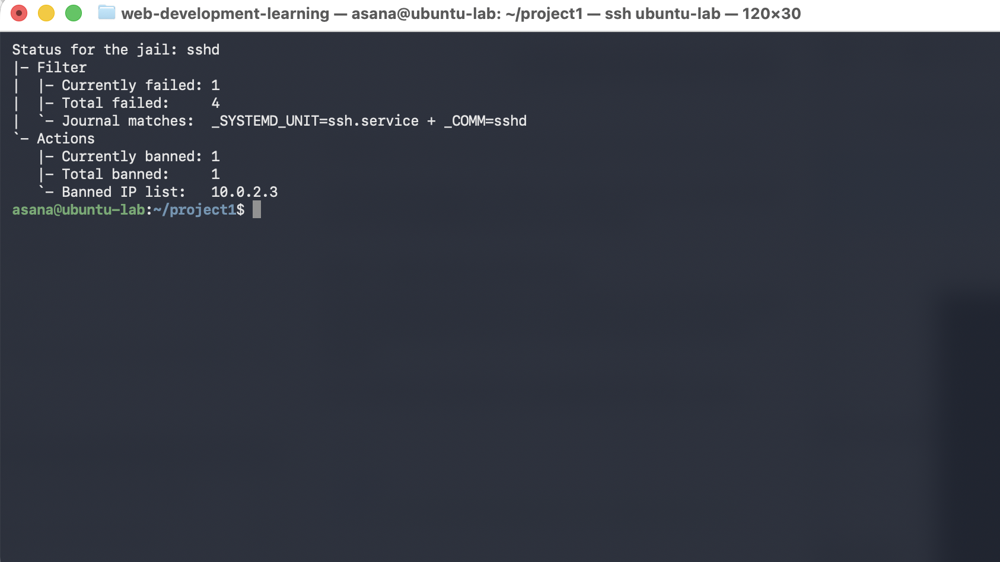
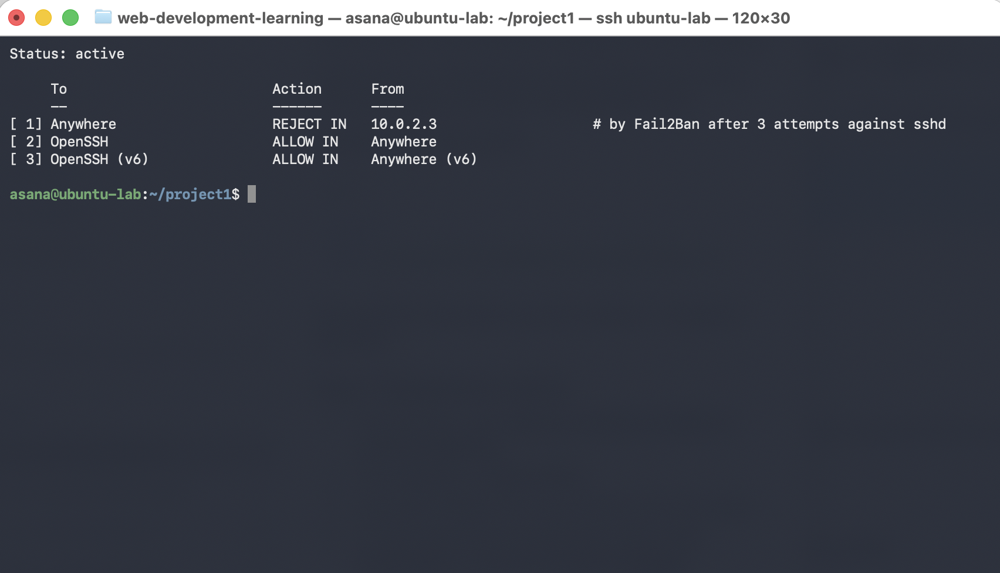

# Linux server hardening lab

I wanted to learn how to actually secure a Linux server instead of just reading about it, so I set up a small lab: an Ubuntu VM as the server and a Kali VM to attack it. I measured how secure Ubuntu was out of the box, hardened it, then tried to break in from Kali to see if my changes held up.

Lynis hardening score went from 63 to 72.

## Setup

- MacBook Air (Apple Silicon) running VirtualBox
- Ubuntu 26.04.1 LTS (ARM64) at 10.0.2.15, the server
- Kali Linux (ARM64) at 10.0.2.3, the "attacker"
- Both on an isolated NAT network so nothing leaves the lab
- I SSH into Ubuntu from my Mac through a port forward that only listens on 127.0.0.1

## What I did

**Baseline.** Ran `lynis audit system` on a fresh install. Score was 63. It flagged that there was no firewall, no intrusion prevention and no malware scanner. The original report is in `before-lynis-report.dat`.

**Firewall.** Turned on UFW with default deny for incoming traffic and only allowed SSH.

**SSH.** Set up key-based login from Kali and my Mac, then turned off password login completely. Also disabled root login, limited SSH to my user, and cut the number of login attempts to 3. My config is in `configs/01-hardening.conf`. To check it worked, I forced a password login from Kali and got `Permission denied (publickey)` with no password prompt.

**fail2ban.** 3 failed logins in 10 minutes gets an IP banned for an hour through UFW. My Mac's address is whitelisted so I can't lock myself out.

**rkhunter.** Rootkit scanner that runs daily. The first scan gave 4 warnings. I checked each one before whitelisting it (notes in `evidence/rkhunter-triage.md`). All four turned out to be normal Ubuntu behavior. One was because rkhunter doesn't read config files in `sshd_config.d/`, which is where I'd set `PermitRootLogin no`.

## Testing it from Kali

I tried logging in as a user that doesn't exist, over and over. The first couple of tries got `Permission denied`. After that fail2ban banned Kali and the next attempts got `Connection refused`, so the firewall was dropping it completely. The ban output and logs are in `evidence/`.

## Problems I ran into

- When copying my SSH key to Ubuntu I kept typing my new key passphrase instead of my Ubuntu password. I only figured that out by reading `journalctl -u ssh`, which showed two failed passwords and then a timeout.
- After installing fail2ban, the status command said it couldn't find the socket. I assumed the install broke, but the logs showed it had started fine. I'd just checked too quickly.
- My first SSH login from the Mac got disconnected while I was checking the host key fingerprint. That was my own 30 second `LoginGraceTime` setting kicking in.
- Mixed up a capital O and a zero in a `wget` flag. Small thing, cost me a few minutes.

## Files

- `configs/` has the SSH, fail2ban and rkhunter configs
- `evidence/` has command output showing each piece working
- `before-lynis-report.dat` and `evidence/after-lynis-report.dat` are the two audits

## What I want to do next

- Work through more of the Lynis suggestions and get the score higher
- Write an Ansible playbook so I can apply all of this to a new server in one go
- Send the logs to a SIEM instead of checking them by hand
